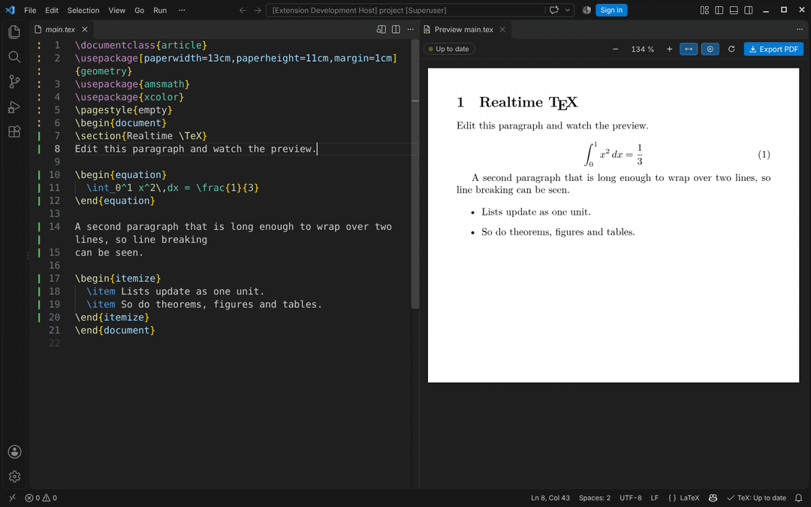

# Realtime TeX Live Preview

English | [简体中文](README.zh-CN.md)

A live LaTeX preview for VS Code that keeps up with your typing. It is built on
[realtime-tex (rtex)](https://github.com/HenryXiaoYang/realtime-tex), which keeps LuaTeX running and
re-typesets only the paragraph you are editing, in about a millisecond. Page breaks,
references and bibliographies follow from a full compile in the background.



## Quick start

1. Open a folder with a LaTeX project. Linux, macOS and Windows are supported.
2. Open a `.tex` file and click the **preview icon** in the editor title bar, or press **Ctrl+Alt+V** (**Cmd+Alt+V** on Mac).
3. Start typing.

On first use, the preview walks you through anything that is missing:

- **rtex is not installed.** Click **Install rtex**. It downloads the prebuilt engine of the latest [kenny-21342/realtime-tex release](https://github.com/kenny-21342/realtime-tex/releases) (the fork of realtime-tex this extension follows) for your platform (a few MB) and checks its SHA-256. Prefer to build it yourself? **Build from Source** clones the fork's `kenny/main` and builds it with Rust's `cargo` (a few minutes; on Windows it also needs [Git for Windows](https://git-scm.com/download/win) and the Visual Studio C++ Build Tools that [rustup](https://rustup.rs) asks for). The `realtimeTex.installFrom` setting picks which one **Install rtex** does.
- **LuaLaTeX was not found.** Choose your TeX Live `bin` folder, or let the extension install a minimal TeX Live 2026.

**Realtime TeX: Check Setup** in the command palette checks everything and offers a fix for each problem.

The extension keeps the rtex it installed up to date, the way it was installed: a downloaded rtex updates to the latest release, one built from source pulls realtime-tex `main` and rebuilds it. It checks once a day and offers **Update Now**; **Realtime TeX: Update rtex Engine** updates on demand and restarts the engine. The `realtimeTex.updateCheck` setting controls this.

The extension updates itself too. It is not on the Marketplace: every change merged into this repository's `main` is built and published as the `main-build` prerelease, and once a day the extension installs a newer build by itself (checked against its published SHA-256), then offers **Reload Window**. `realtimeTex.extensionUpdates` picks `main` (every merged change, the default), `releases` (tagged releases only) or `off`; **Realtime TeX: Check for Extension Updates** checks now.

## Using the preview

| | |
|---|---|
| **Toolbar** | Status pill · zoom − / + · **Fit width** · **Follow cursor** · **Recompile** · **Export PDF** |
| **Status pill** | **Live · 0.8 ms** means the paragraph was re-typeset that fast. **Updating layout…** means a full compile is placing pages, references and floats. **Up to date** means everything matches. **N errors** opens the Problems panel. |
| **Live markers** | A bar next to the line numbers shows how each part of your source updates: **solid green** updates live as you type, **dotted amber** waits for the full compile (the preamble, TikZ, …). Hover over a part that went to the full compile to see why. |
| **Follow cursor** | The preview scrolls to the paragraph you are editing. **Ctrl+Alt+J** jumps there on demand. |
| **Jump to source** | Double-click (or Ctrl/Cmd+click) a paragraph in the preview. |
| **Zoom** | Ctrl + mouse wheel, Ctrl + = / − / 0 |
| **Export PDF** | **Ctrl+Alt+E**. Writes `main.pdf` next to the main file. The result matches a clean LuaLaTeX build. |
| **Errors** | LaTeX errors and warnings appear in the Problems panel and as squiggles. |

The **main file** is found automatically. The extension looks for, in order:

1. a `% !TEX root = main.tex` comment;
2. the file with `\documentclass`;
3. the file that `\input`s or `\include`s the one you are editing.

If it is ambiguous, the preview asks you to choose. The choice is saved in `realtimeTex.mainFile`.

### What updates instantly

Body text, inline and display math, `\ref`/`\eqref`/`\cite` (with the numbers from the last
full compile), lists, theorems, figures and tables (content), and headings all update with each
keystroke. Everything else updates with the next full compile, typically a second or two later:

- preamble changes;
- TikZ;
- moved floats;
- footnote text at the bottom of the page;
- new page breaks.

The pill says when this is happening. See rtex's
[live editing guide](https://github.com/kenny-21342/realtime-tex/blob/kenny/main/docs/live-editing.md) for details.

**While you type something incomplete**, such as a half-typed coordinate in a TikZ picture, the
preview keeps showing the last good version of that picture (or of the part typed live), with a
dashed amber outline labelled "editing", until the errors are fixed. The errors still show in the
Problems panel. It needs rtex 0.0.6 or later; `realtimeTex.engine.holdBrokenPictures` turns it off.

For the fastest updates, use TFM fonts (the default, `lmodern`, …) or OpenType fonts loaded with
`Renderer=Basic`. fontspec's default node mode works, but each keystroke takes longer.

### How pages are drawn

The preview draws rtex's display lists itself, so a keystroke repaints a single paragraph without a
PDF round trip. It supports:

- OpenType/TrueType fonts, by glyph index;
- Type1 fonts, such as Computer Modern math and `lmodern`, found through TeX's `pdftex.map`;
- colors, rules, PNG/JPEG/PDF images and graphicx scaling;
- TikZ/pgf drawings (paths, fills, strokes, dashes, clips, opacity, axial and radial shadings,
  rotated or scaled node text), including pictures reused from the picture cache, when the engine
  sends their drawing (`native` in rtex's page updates; rtex with native drawing, see below).

Some pages still cannot be drawn this way, for example tiling patterns or other `\special`s. Those
are shown from the background PDF, marked with a small **from PDF** badge, and edits on them still
appear live on top. With an rtex build that has no native drawing, every TikZ page is shown from the
PDF, as before.

## Settings

| Setting | Default | |
|---|---|---|
| `realtimeTex.serverPath` | *(auto)* | rtex binary. Empty means the one installed by **Install rtex**, then `rtex` on `PATH`. |
| `realtimeTex.texliveBin` | *(PATH)* | Folder containing `lualatex`. |
| `realtimeTex.texDir` | *(auto)* | rtex's `tex/` support files. Only needed if you moved the binary away from them. |
| `realtimeTex.installFrom` | `release` | What **Install rtex** does: `release` downloads the prebuilt engine, `source` builds `realtimeTex.engine.repository` with `cargo`. |
| `realtimeTex.updateCheck` | `notify` | Once a day, check for a newer engine (a new release, or new commits on the engine's repository and branch for a source build): `notify` offers the update, `auto` updates by itself, `off` never checks. The setting has an **Update rtex now** link. |
| `realtimeTex.extensionUpdates` | `main` | Once a day, install a newer version of this extension: `main` the latest build of `main` (every merged change), `releases` the latest tagged release, `off` never (use **Check for Extension Updates**). |
| `realtimeTex.extensionRepository` | *(this repository)* | GitHub repository (`owner/name` or URL) the extension updates itself from. |
| `realtimeTex.engine.repository` | *(kenny-21342/realtime-tex)* | Git repository the engine comes from, e.g. upstream HenryXiaoYang/realtime-tex or another fork: built from source, and when it is on GitHub, the repository whose releases **Install rtex** downloads. |
| `realtimeTex.engine.branch` | `kenny/main` | Branch of that repository for source builds (empty: `kenny/main` for the default repository, `main` for any other). Changing either and running **Update rtex Engine** switches the managed checkout. |
| `realtimeTex.engine.eligibility` | `probe` | How rtex picks the parts that update live: `probe` (compare a live result with the last full compile) or `allowlist` (only known-safe commands). |
| `realtimeTex.engine.fastBudgetMs` | `50` | Time budget for re-typesetting one part live; a part that takes longer three times in a row waits for the full compile. |
| `realtimeTex.engine.fastBudgetFactor` | `4` | The budget follows the document: a part is only too slow when it also takes longer than this many times the document's typical live update (`0`: the fixed budget alone). |
| `realtimeTex.engine.passTimeoutSeconds` | `120` | A full compile still running after this long is stopped (a document that loops forever). |
| `realtimeTex.engine.pictureCache` | `true` | Reuse unchanged TikZ pictures from the previous full compile. |
| `realtimeTex.engine.holdBrokenPictures` | `true` | While an edit leaves a TikZ picture (or a part typeset live) with errors, keep showing its last good version, outlined, until the errors are fixed. |
| `realtimeTex.debug.enabled` | `false` | rtex saves a debug bundle (source, context, trace, TeX log) whenever the live engine hangs or crashes, and lists every live compile in `requests.log`. **Open Debug Folder** shows them. |
| `realtimeTex.debug.directory` | *(storage)* | Where debug bundles go. |
| `realtimeTex.mainFile` | *(auto)* | Main file, relative to the workspace folder. |
| `realtimeTex.buildDir` | *(storage)* | Where rtex keeps build files. Empty keeps them out of your project. |
| `realtimeTex.exportPath` | `${mainDir}/${mainName}.pdf` | Where **Export PDF** writes. |
| `realtimeTex.syncCursor` | `true` | Preview follows the cursor. |
| `realtimeTex.editor.liveMarkers` | `true` | Live/full-compile bars next to the line numbers. |
| `realtimeTex.autoStart` | `false` | Start the engine when a LaTeX file opens, without waiting for the preview. |
| `realtimeTex.stopWhenPreviewCloses` | `true` | Stop the engine when the preview closes. |
| `realtimeTex.preview.zoom` | `fitWidth` | Initial zoom. |
| `realtimeTex.preview.invertInDarkTheme` | `false` | Dark pages in dark themes. |

## Commands

All commands are under **Realtime TeX:** in the command palette:

- **Open Live Preview to the Side**
- **Export PDF**
- **Recompile Whole Document**
- **Show Cursor Position in Preview**
- **Restart Engine**
- **Stop Engine**
- **Show Log**
- **Open Debug Folder**
- **Check Setup**
- **Install rtex**
- **Install rtex (Build from Source)**
- **Update rtex Engine**
- **Check for Extension Updates**
- **Locate rtex Binary…**
- **Choose Main File…**
- **Get Started**

## Development

```bash
npm install
npm run build        # dist/extension.js, dist/webview.js
npm test             # unit tests (node:test)
npm run typecheck
npm run package      # .vsix
```

Press F5 in VS Code to start an Extension Development Host.

The integration suite drives a real VS Code with the real engine. It needs a built rtex and
TeX Live:

```bash
RTEX_E2E_SERVER=/path/to/realtime-tex/target/release/rtex \
RTEX_E2E_TEXLIVE_BIN=/path/to/texlive/2026/bin/x86_64-linux \
xvfb-run -a npm run test:e2e
```

On macOS and Windows, run `npm run test:e2e` without `xvfb-run`. The **E2E** workflow runs the suite on
Linux, macOS and Windows against the latest realtime-tex.

### Releasing

Set `version` in `package.json` and add a `## <version>` section to `CHANGELOG.md`, then push a
matching tag:

```bash
git tag v0.0.1 && git push origin v0.0.1
```

The **Release** workflow builds the `.vsix`, checks that the tag matches `package.json`, and
creates the GitHub release with the changelog section as notes and the `.vsix` (plus its
SHA-256) attached. Publishing a release in the GitHub UI, or running the workflow by hand with a
tag, attaches the `.vsix` to an existing release.
### Render check

`test/render` draws rtex page lists with the preview's own drawing code in headless Chromium and
compares the result with MuPDF's rendering of the PDF. It needs realtime-tex's `gfx_dump` example,
playwright-core with a Chromium, and PyMuPDF:

```bash
npm run build:render
# page*.json: page lists saved by rtex (verify or the native_session example); layout.pdf: their PDF
/path/to/realtime-tex/target/debug/examples/gfx_dump BUILD/page*.json > gfx.jsonl
CHROMIUM=/path/to/chrome PLAYWRIGHT_CORE=/path/to/node_modules/playwright-core \
  node out/render/run.js OUT 150 gfx.jsonl      # OUT/pageN.png, OUT/summary.json
python3 test/render/compare.py BUILD/layout.pdf OUT 150 --diff 3   # per-page diff, 3 diff images
```

The check loads fonts the way the extension does but not raster images (such pages report "an
image has no source file"; the preview itself loads them), so it covers text, rules and native
drawing. `--max 0.06 --require-native` makes it a gate: the `render` job of the E2E workflow runs
it on realtime-tex's picture corpus for every pull request (anti-aliasing and hinting alone
differ in about 3% of the ink).

### Layout

| Path | |
|---|---|
| `src/extension.ts` | Activation, commands, main-file resolution, editor events |
| `src/session.ts` | One `rtex serve` session: buffer sync, events → diagnostics/status/preview, export, source ↔ preview mapping |
| `src/rtexProcess.ts` | The `rtex serve` JSON-lines child process |
| `src/edits.ts` | VS Code changes (UTF-16) → rtex byte edits (UTF-8) |
| `src/resources.ts`, `src/type1.ts` | Font and image loading; Type1 fonts and `pdftex.map` → glyph outlines |
| `src/gutter.ts`, `src/liveMarks.ts` | The live/full-compile markers next to the line numbers |
| `src/preview/panel.ts` | The webview panel and its message protocol |
| `src/setup.ts`, `src/config.ts` | Setup check, rtex/TeX Live installation, settings |
| `webview/` | The preview: page/overlay model, canvas renderer, pdf.js fallback, toolbar |
| `webview/native.ts` | Native drawing: which pages qualify, ops by item, colors, shading geometry |
| `test/render/` | Render check against MuPDF (above) |

## License

MIT

With the engine update planned for rtex v0.0.7, editing TikZ/pict2e labels keeps the axes,
lines and rotated labels together. With an older engine or an unsupported picture, the preview
keeps its complete previous drawing until the full compile. This fallback also applies when
**Hold Broken Parts** is disabled.
